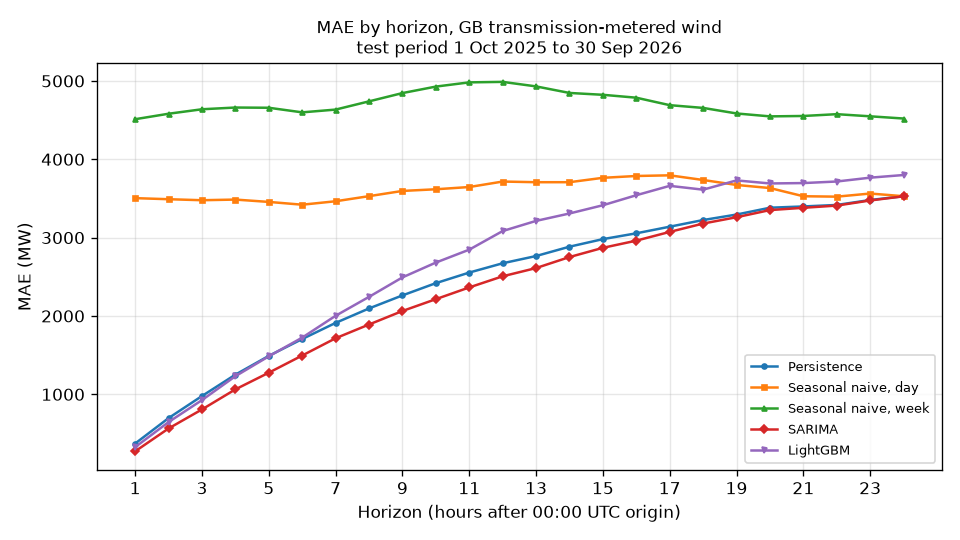
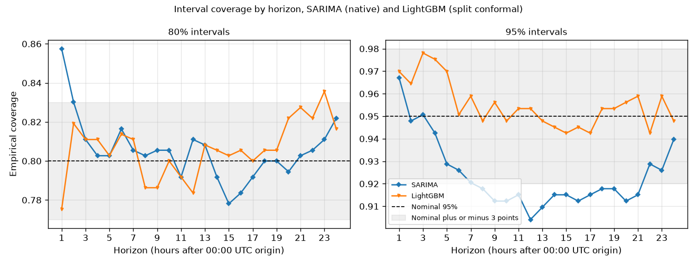

# Applied forecasting / predictive pipeline

Lane: Applied ML
Use for: Applied ML, industrial ML, sustainability/data systems PhDs
Plan slot: 20 to 30 Oct 2026
Status: wip

## Deliverables
- Cleaned public GB grid time series (NESO Historic GB Generation Mix)
- Target: GB transmission-metered wind generation (NESO WIND column, excludes embedded wind), hourly, forecast day-ahead (next 24 hours)
- Baselines (seasonal naive, SARIMA) + LightGBM on lag and calendar features
- Error analysis and uncertainty notes

## Results

Each day from 1 Oct 2025 to 30 Sep 2026, every model forecast the next 24 hours from 00:00 UTC, using only data available at that time: 365 forecasts and 8,760 scored hours. The target is GB transmission-metered wind generation (NESO WIND column, excludes embedded wind), as hourly mean MW. Every choice below (models, features, training windows, intervals, metrics) was fixed in PROTOCOL.md before any model was fitted. The primary metric is MAE relative to persistence: below 1 means the model is more accurate than holding the last observed value flat.

### Pre-specified results

| Model | MAE relative to persistence | MAE (MW) | RMSE (MW) | MAE relative to seasonal naive, day | MAE relative to seasonal naive, week |
|---|---|---|---|---|---|
| SARIMA(1,1,0)(1,0,1,24) | **0.951** | 2,337 | 3,328 | 0.650 | 0.497 |
| Persistence | 1.000 | 2,457 | 3,432 | 0.683 | 0.523 |
| LightGBM | 1.100 | 2,702 | 3,659 | 0.751 | 0.575 |
| Seasonal naive, day | 1.465 | 3,598 | 4,660 | 1.000 | 0.765 |
| Seasonal naive, week | 1.914 | 4,701 | 5,869 | 1.307 | 1.000 |

SARIMA beats persistence: its MAE is 4.9% lower (ratio 0.951). The gain is largest at short horizons (272 against 372 MW at hour 1) and shrinks with horizon until the two are level at hour 24 (3,528 against 3,529 MW).

The pre-specified LightGBM does not beat persistence (ratio 1.100). It is better at hours 1 to 5 and worse from hour 6 on. Diagnostics point to overfitting: at hour 24 its training error was about a tenth of its error on held-out data from before the test period, and the target hour's day-of-year features carried about a third of the model's gain. With a one-year training window, day of year and hour of day almost identify each target hour, so the model can learn dates rather than how wind generation evolves.

Full metrics, overall and for each horizon: results/model_metrics.csv and results/model_metrics_by_horizon.csv.

### Prediction intervals

| Model | Interval method | Coverage, 80% nominal | Mean width, 80% (MW) | Coverage, 95% nominal | Mean width, 95% (MW) |
|---|---|---|---|---|---|
| SARIMA | Gaussian, from the model | 80.6% | 7,860 | 92.4% | 12,021 |
| LightGBM | Split conformal | 80.6% | 8,816 | 95.5% | 13,689 |

LightGBM's split conformal intervals stay within 3 percentage points of nominal at 95% for every horizon (94.2% to 97.8%), and at 80% for every horizon except hour 23 (83.6%). SARIMA's Gaussian intervals cover 92.4% overall at 95% and under-cover at horizons 8 to 21 (90.4% to 91.8%); at 80% they over-cover at hours 1 and 2 (85.8% and 83.0%). The conformal intervals are wider: 13,689 MW on average at 95%, against 12,021 MW for SARIMA.

### Post-hoc analysis (not pre-specified)

After the results above were known, one variant was run and recorded in the PROTOCOL.md change log: the same LightGBM without the target hour's day-of-year sine and cosine features, with everything else unchanged. It was chosen after seeing test results, so its numbers are likely to be optimistic as an estimate for new data. It does not replace the pre-specified result.

| Model | MAE relative to persistence | MAE (MW) | RMSE (MW) | Coverage, 80% | Coverage, 95% |
|---|---|---|---|---|---|
| LightGBM without day-of-year features (post-hoc) | 1.029 | 2,527 | 3,368 | 79.1% | 96.1% |
| LightGBM (pre-specified) | 1.100 | 2,702 | 3,659 | 80.6% | 95.5% |
| SARIMA (pre-specified) | 0.951 | 2,337 | 3,328 | 80.6% | 92.4% |

Removing the two features lowers MAE by 6.5%, which is consistent with the overfitting diagnosis, but the variant still does not beat persistence overall. It is better than persistence at hours 1 to 6 only and does not beat SARIMA at any horizon. Its 95% intervals stay within 3 points of nominal at every horizon; its 80% intervals under-cover at hours 10 (76.7%) and 23 (77.0%). Metrics: results/posthoc_lgbm_no_doy.csv and results/posthoc_lgbm_no_doy_by_horizon.csv.

### Limitations

- No weather forecasts are used, although operational day-ahead wind forecasts depend on them. These results measure what the generation history alone can do.
- The backtest assumes outturn up to the origin is available at the origin. In practice publication lags slightly.
- NESO applies its own correction to missing or irregular points before publishing, so some values may already be imputed.
- One test year is a single realisation of weather; results may differ in another year.

## Links (fill when live)
- GitHub:
- PDF / note:
- Dataset source:

## Notes
Keep commits small and README honest about limits. Prefer one solid result over many unfinished notebooks.
